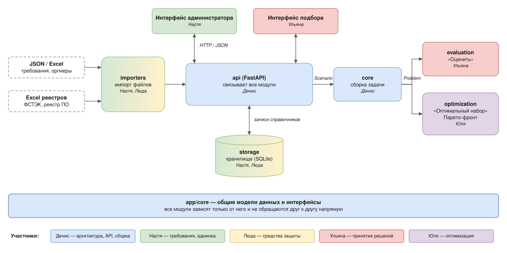
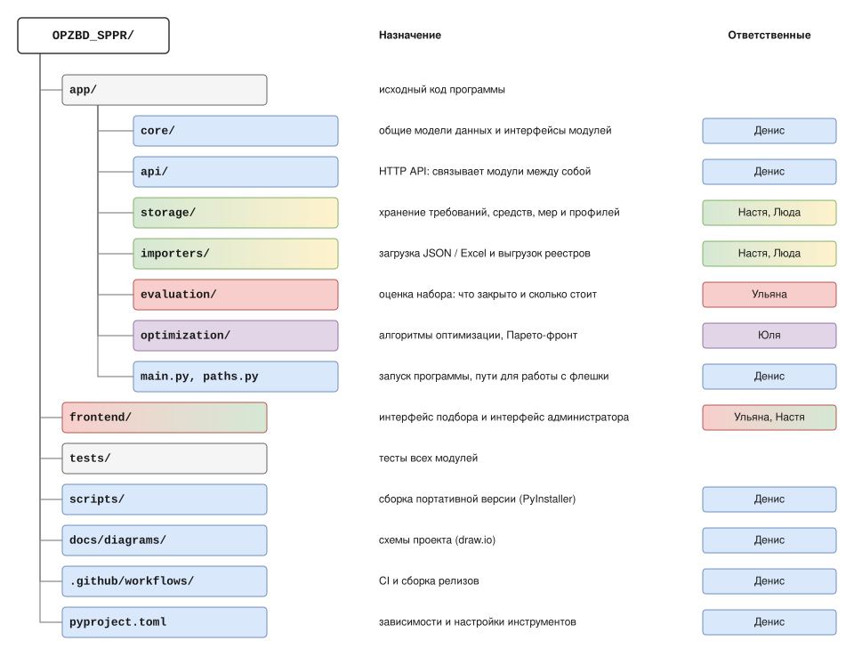

# СППР: подбор средств и мер защиты информации

Система поддержки принятия решений для выбора средств защиты информации
и организационных мер под нормативные требования.

Пользователь выбирает требования и профиль обязательности, отмечает средства
и меры, вводит их стоимость и период и получает:

- **оценку набора** — закрыты ли все обязательные требования и сколько это стоит;
- **оптимальный набор** — по выбранному алгоритму, с Парето-фронтом
  «стоимость / число закрытых требований».

Программа работает без установки: её можно запустить с флешки на Windows
и Linux, интерфейс открывается в браузере.

## Как устроен проект



### Структура репозитория



Схемы лежат в `docs/diagrams/` в формате `.drawio.svg`: их можно открыть и
отредактировать в [draw.io](https://app.diagrams.net) или в VS Code с расширением
Draw.io Integration, а в README они показываются как обычные картинки.

## Команда

| Участник | Зона ответственности |
|---|---|
| Денис | Архитектура, интерфейсы модулей, репозиторий, сборка |
| Настя | Требования, оргмеры, профили обязательности, интерфейс администратора |
| Люда | Средства защиты, импорт выгрузок реестров |
| Ульяна | Модуль принятия решений, интерфейс подбора |
| Юля | Алгоритмы оптимизации, Парето-фронт |

## Запуск из исходников

Нужен Python 3.10 или новее.

```bash
python -m venv .venv
# Linux:   source .venv/bin/activate
# Windows: .venv\Scripts\activate

pip install -e ".[dev]"
python run.py
```

Описание API — на странице `/docs` запущенной программы.

Проверки: `ruff check .`, `ruff format --check .`, `pytest`.

## Портативная версия

```bash
pip install -e ".[build]"
python scripts/build.py
```

Результат — `dist/SZI-windows.zip` или `dist/SZI-linux.zip`. Собирать нужно на
той ОС, для которой нужна версия. Обе версии также собирает GitHub Actions:
**Actions → Release → Run workflow** или тег вида `v0.1.0`.

Запуск: `start-windows.bat` или `start-linux.sh` из распакованной папки.
