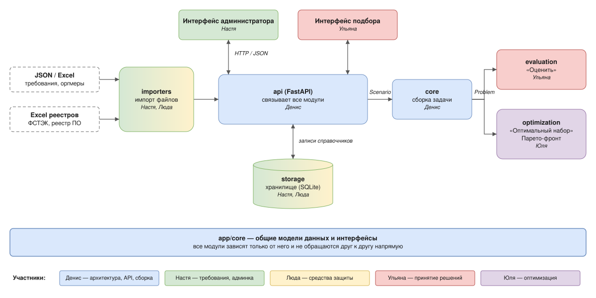
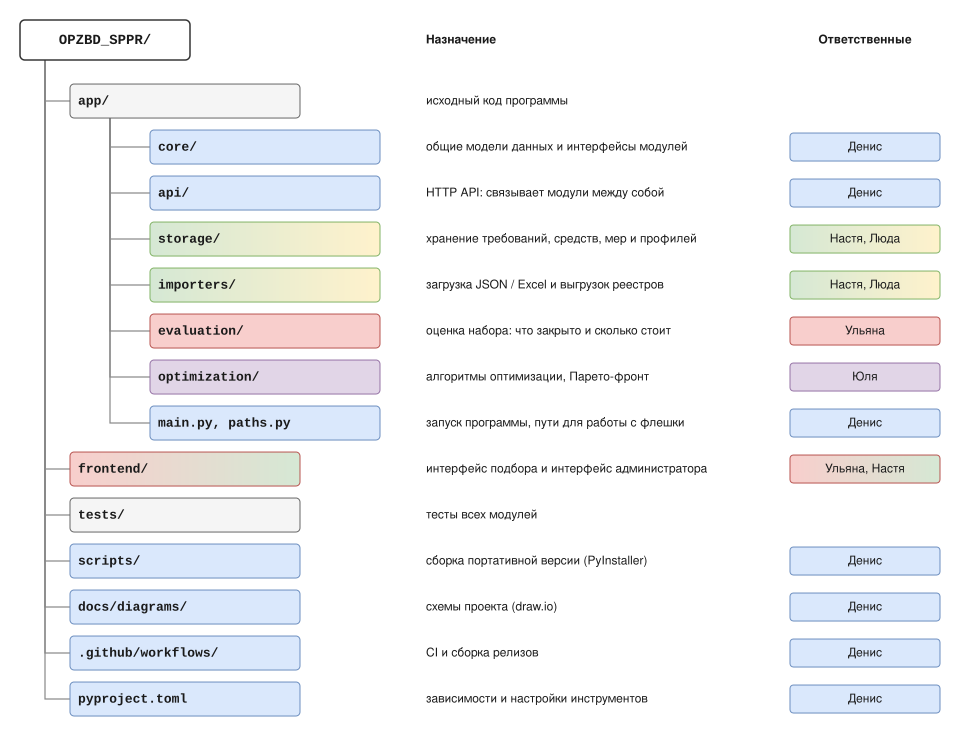

# СППР: подбор средств и мер защиты информации

Система поддержки принятия решений для выбора средств защиты информации
и организационных мер под нормативные требования.

Пользователь выбирает требования и профиль обязательности, отмечает средства
и меры, вводит их стоимость и период и получает:

- **оценку набора** — закрыты ли все обязательные требования и сколько это стоит;
- **оптимальный набор** — по выбранному алгоритму, с Парето-фронтом
  «стоимость / число закрытых требований».

Программа портативная и работает без установки на Windows и Linux.
Её можно запускать из папки на компьютере или с флешки; интерфейс открывается
в браузере.

## Как устроен проект



### Структура репозитория



Схемы лежат в `docs/diagrams/` в формате `.drawio.svg`: их можно открыть и
отредактировать в [draw.io](https://app.diagrams.net) или в VS Code с расширением
Draw.io Integration, а в README они показываются как обычные картинки.

## Команда

| Участник | Зона ответственности |
|---|---|
| Денис | Архитектура, интерфейсы модулей, репозиторий, сборка |
| Настя | Требования, оргмеры, профили обязательности, интерфейс администратора |
| Люда | Средства защиты, импорт выгрузок реестров |
| Ульяна | Модуль принятия решений, интерфейс подбора |
| Юля | Алгоритмы оптимизации, Парето-фронт |

## Запуск из исходников

Нужен Python 3.10 или новее.

```bash
python -m venv .venv
# Linux:   source .venv/bin/activate
# Windows: .venv\Scripts\activate

pip install -e ".[dev]"
python run.py
```

Описание API — на странице `/docs` запущенной программы.

Проверки: `ruff check .`, `ruff format --check .`, `pytest`.

## Локальные аккаунты и черновики

На странице входа нажмите «Создать аккаунт», задайте логин и пароль, затем войдите.
У каждого аккаунта свой черновик: программа запоминает профиль, выбранные требования
и позиции, цены, период, алгоритм и бюджет. При следующем входе черновик загружается
автоматически. Аккаунты и черновики хранятся в файле `data/auth.sqlite3`.

## Реестр ПО без доступа к сайту

Импортированные записи и цены хранятся локально в `data/catalog.sqlite3`.
Скопируйте этот файл при закрытом приложении, чтобы сделать резервную копию базы.
После успешного скачивания исходный XML или XLS сохраняется в `data/registry-cache/`.
Если сайт недоступен, интерфейс покажет путь к последней сохранённой выгрузке выбранного формата.

Для импорта JSON используйте массив записей или объект с массивом `records`.
В каждой записи нужны регистрационный номер `reg_number` и, если есть, название `name`.


## Соответствия средств и мер требованиям

В «Средствах» на вкладке «Соответствия» найдите средство и нажмите «Изменить
требования». Отметьте или снимите требования в списке и сохраните изменения.

В «Средствах» на вкладке «Скачивание» и в разделе «Меры» можно скачать XLSX
с предложениями. Они основаны
на классах ПО, названиях и описаниях из локальной базы. Ссылки на документацию
помогут проверить функции продукта и его версию.

Для подтверждения укажите «Принять» в столбце «Решение». Пустые и отклонённые
строки пропускаются. Для готовой таблицы достаточно двух столбцов «Код позиции»
и «Код требования». Загрузите файл в нужном разделе, нажмите «Проверить», затем
«Применить». При ошибке сохранение всего файла отменяется. Импорт дополняет
существующие связи и пропускает повторы.
